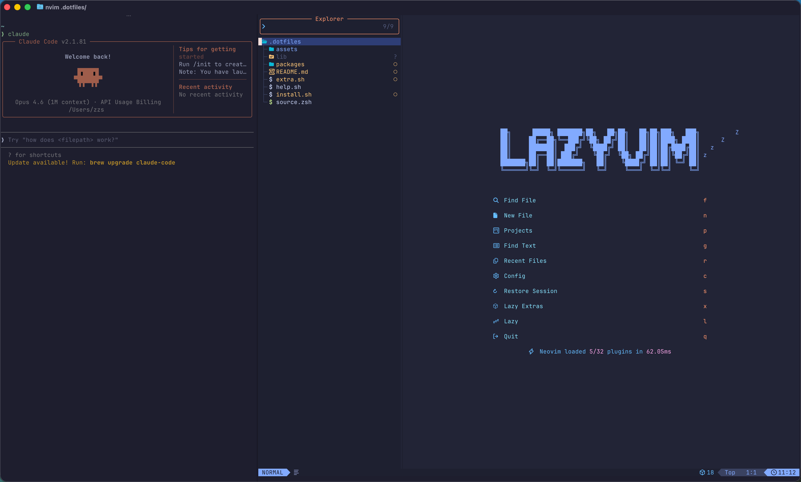

# dotfiles

> 一行命令，把一台空 macOS 装成趁手的开发机。

[](https://www.apple.com/macos/)
[](https://support.apple.com/HT211814)
[](https://zsh.org/)
[](#license)

<p align="center">
  
</p>

## 这是什么

`36node/dotfiles` 是一套面向 macOS 开发者的环境初始化方案。从全新系统到一台
**「装着趁手工具、终端美观、Finder 干净、各种语言版本管理就绪、敏感凭据自动跨机同步」**
的开发机，一条命令搞定，反复执行不出错。

不同于市面常见 dotfiles，本仓库优先选用 **2024–2026 年仍在快速迭代的现代化轻量栈**，
而不是十年来惯性沿用的老组合。

## 适合谁

**适合**：

- 频繁换 Mac、或团队/新人 onboarding 想要一致开发环境
- 国内（或国内出海）开发者 —— 默认就装阿里云 CLI、飞书、微信，Homebrew / Python 源码默认走国内镜像
- 想读得懂自己装了什么的人 —— 核心就是一个 `install.sh` 加几个 `lib/` 函数，全是带注释的 bash

## 核心特点

- **模块化** —— `packages/` 下每个目录是一个独立 package，主脚本自动遍历，互不依赖
- **幂等** —— 所有写入走 `append` / `link_file`，反复跑不会副作用堆叠
- **现代化** —— 见下方"技术栈"，全部 2026 年仍活跃维护的项目
- **可读** —— 主 `install.sh` 从上往下顺序执行、注释比代码多，每个 package 自带 README，没有黑魔法
- **跨机同步敏感凭据** —— `.env` / `~/.ssh` 通过 vault + 软链方案自动同步，默认走 iCloud Drive，可换 Dropbox / Syncthing / 任意目录
- **macOS 系统调优** —— Finder / Dock / 键盘 / 截图路径等开箱即用，每条注释完整

## 技术栈

| 角色 | 选用 | 旧时代做法 |
|---|---|---|
| 终端 | [ghostty](https://ghostty.org/) | iTerm2 / Terminal.app |
| Shell 插件管理 | [antidote](https://getantidote.github.io/) | oh-my-zsh |
| Prompt | [starship](https://starship.rs/) (tokyo-night) | powerlevel10k |
| Node 版本管理 | [fnm](https://github.com/Schniz/fnm) | nvm |
| Node 包管理 | corepack (pnpm / yarn) | 全局 npm install |
| Python | [pyenv](https://github.com/pyenv/pyenv) + 3.14 | system python |
| 编辑器 | [LazyVim](https://www.lazyvim.org/) (neovim) | 自配 .vimrc |
| 字体 | JetBrains Mono Nerd Font | — |
| 容器/编排 | docker + kubernetes-cli + kubectx + helm + k9s | — |
| 国内云 | aliyun-cli | — |
| 通用 CLI | 见下方「命令行工具速查」 | — |

## 命令行工具速查

下面是仓库里装的主要 CLI 工具，按主题分组，每个工具都附了官方仓库/文档链接。
完整清单以根目录 `Brewfile` 和各 `packages/<name>/Brewfile` 为准（见「[软件清单：Brewfile](#软件清单brewfile)」）。

### 文件浏览 / 跳转

| 工具 | 功能 |
|---|---|
| [yazi](https://github.com/sxyazi/yazi) | TUI 文件管理器，原生预览图片/视频/PDF（依赖 ffmpeg/imagemagick/poppler/sevenzip） |
| [eza](https://github.com/eza-community/eza) | `ls` 替代：彩色 + git 状态 + tree 模式 |
| [fd](https://github.com/sharkdp/fd) | `find` 替代：更快、默认忽略 `.git` 和 `.gitignore` |
| [zoxide](https://github.com/ajeetdsouza/zoxide) | `cd` 替代：按访问历史智能跳转，输入 `z foo` 直达；`zi` 走 fzf 交互式选 |
| [tree](https://github.com/Old-Man-Programmer/tree) | 经典目录树 |

### 搜索 / 查看

| 工具 | 功能 |
|---|---|
| [ripgrep](https://github.com/BurntSushi/ripgrep) (`rg`) | `grep` 替代，超快 |
| [fzf](https://github.com/junegunn/fzf) | 模糊查找器，被 zoxide / yazi / zsh 历史搜索等多处依赖 |
| [bat](https://github.com/sharkdp/bat) | `cat` 替代：语法高亮 + 行号 + git diff |
| [jless](https://github.com/PaulJuliusMartinez/jless) | TUI JSON viewer，搭配 [jq](https://jqlang.github.io/jq/) 用：jq 处理、jless 浏览 |
| [glow](https://github.com/charmbracelet/glow) | 终端里渲染 markdown，看 README 不用切到 IDE |

### 进程 / 资源监控

| 工具 | 功能 |
|---|---|
| [bottom](https://github.com/ClementTsang/bottom) (`btm`) | `top` / `htop` 替代，跨平台 Rust 实现 |
| [mactop](https://github.com/context-labs/mactop) | macOS 专用，显示 Apple Silicon CPU/GPU 频率 + 能耗 |
| [procs](https://github.com/dalance/procs) | `ps` 替代，彩色更易读 |
| [dust](https://github.com/bootandy/dust) | `du` 替代，树形可视化谁占硬盘 |
| [duf](https://github.com/muesli/duf) | `df` 替代，彩色磁盘容量表 |

### Git / 版本控制

| 工具 | 功能 |
|---|---|
| [git](https://git-scm.com/) | 当然是 git |
| [gh](https://cli.github.com/) | GitHub 官方 CLI（`gh pr`、`gh issue` 等） |
| [lazygit](https://github.com/jesseduffield/lazygit) | Git TUI，键盘流操作 |
| [delta](https://github.com/dandavison/delta) | git diff 美化 pager（`install.sh` 已自动注册到 `~/.gitconfig`） |
| [git-lfs](https://git-lfs.com/) | Git 大文件存储 |
| [actionlint](https://github.com/rhysd/actionlint) | GitHub Actions workflow 静态检查 |

### Kubernetes / 容器

| 工具 | 功能 |
|---|---|
| [kubectl](https://kubernetes.io/docs/reference/kubectl/) | k8s 官方 CLI（包名 `kubernetes-cli`） |
| [kubectx / kubens](https://github.com/ahmetb/kubectx) | 快速切换 context / namespace |
| [kubecolor](https://github.com/kubecolor/kubecolor) | 给 kubectl 输出着色 |
| [helm](https://helm.sh/) | k8s 包管理器（PATH 上是 `helm@3`；helm 4 装着但不链接） |
| [k9s](https://github.com/derailed/k9s) | k8s TUI 管理工具 |
| [k3sup](https://github.com/alexellis/k3sup) | 一键部署 k3s 到任何机器 |
| [docker / docker-compose](https://docs.docker.com/) | docker CLI 和 compose 插件（CLI-only，跟 OrbStack 共存时会有 PATH 优先级冲突，详见 `packages/DevOps/Brewfile` 注释） |
| [lazydocker](https://github.com/jesseduffield/lazydocker) | Docker TUI，lazygit 同作者 |
| [skopeo](https://github.com/containers/skopeo) | 不拉镜像直接查看 / 复制远端镜像 |

### 数据库 / 消息

| 工具 | 功能 |
|---|---|
| [libpq](https://www.postgresql.org/docs/current/libpq.html) | `psql` 等 Postgres 客户端（keg-only，Brewfile 里强制链接进 PATH） |
| [redis](https://redis.io/) | Redis 服务端与 `redis-cli` |
| [mosquitto](https://mosquitto.org/) | MQTT broker，附带 `mosquitto_pub` / `mosquitto_sub` |

### 网络 / 远程

| 工具 | 功能 |
|---|---|
| [autossh](https://www.harding.motd.ca/autossh/) | SSH 隧道断线自动重连，配合 `~/.ssh/config` 的 `LocalForward` 用 |
| [xh](https://github.com/ducaale/xh) | `curl` / `httpie` 替代，语法极简 |
| [wget](https://www.gnu.org/software/wget/) | 经典下载器 |
| [iperf3](https://github.com/esnet/iperf) | 网络带宽测试 |
| [telnet](https://www.gnu.org/software/inetutils/) | 测端口连通性 |
| [ngrok](https://ngrok.com/) | 内网穿透（cask） |

### 文本 / 数据

| 工具 | 功能 |
|---|---|
| [jq](https://jqlang.github.io/jq/) | JSON 流处理（标杆工具） |
| [yq](https://github.com/mikefarah/yq) | jq 的 YAML 版，也能处理 JSON / XML |
| [sd](https://github.com/chmln/sd) | `sed` 替代，语法直观 |
| [tokei](https://github.com/XAMPPRocky/tokei) | 代码行数统计 |

### 媒体 / 压缩

| 工具 | 功能 |
|---|---|
| [ffmpeg](https://ffmpeg.org/) | 音视频处理，yazi 视频预览也用它 |
| [imagemagick](https://imagemagick.org/) | 图片格式转换，yazi 图片预览也用它 |
| [poppler](https://poppler.freedesktop.org/) | PDF 处理（提供 `pdftotext` / `pdftoppm`），yazi PDF 预览依赖 |
| [librsvg](https://wiki.gnome.org/Projects/LibRsvg) | 提供 `rsvg-convert`，SVG 转 PNG / PDF |
| [sevenzip](https://github.com/p7zip-project/p7zip) (`7zz`) | 7z 压缩格式，yazi 压缩档预览依赖 |

### Shell / 终端

| 工具 | 功能 |
|---|---|
| [tmux](https://github.com/tmux/tmux) | 终端复用 |
| [antidote](https://getantidote.github.io/) | zsh 插件管理器（替代 oh-my-zsh） |
| [starship](https://starship.rs/) | 跨 shell 的 prompt |
| [direnv](https://direnv.net/) | 进入目录自动加载 `.envrc`，per-project 环境变量（首次 `direnv allow` 授权） |
| [gum](https://github.com/charmbracelet/gum) | 写交互式 shell 脚本的 UI 组件库 |

### AI CLI

| 工具 | 功能 |
|---|---|
| [claude-code](https://www.anthropic.com/claude-code) | Anthropic 的终端 AI 编码助手（cask 分发，但本质是 CLI） |
| [codex](https://github.com/openai/codex) | OpenAI 的终端 coding agent（cask 分发，本质 CLI） |
| [antigravity-cli](https://antigravity.google/product/antigravity-cli) | Google Antigravity 终端 agent（gemini-cli 的官方替代，cask） |

### Cloud / 运维

| 工具 | 功能 |
|---|---|
| [aliyun-cli](https://github.com/aliyun/aliyun-cli) | 阿里云 CLI |
| [gcloud-cli](https://cloud.google.com/sdk/gcloud) | Google Cloud CLI（cask） |
| [ansible](https://www.ansible.com/) | 配置管理与自动化 |

### 构建工具

| 工具 | 功能 |
|---|---|
| [cmake](https://cmake.org/) / [ninja](https://ninja-build.org/) | C/C++ 构建 |
| [emscripten](https://emscripten.org/) | C/C++ 编译到 WebAssembly |
| [dfu-util](https://dfu-util.sourceforge.net/) | USB DFU 固件烧录 |

### 编程语言 / 编辑器

| 工具 | 功能 |
|---|---|
| [go](https://go.dev/) | Go 编译器（直接装稳定版，需要多版本切换可改用 `goenv`） |
| [neovim](https://neovim.io/) | 现代 vim，搭配 [LazyVim](https://www.lazyvim.org/) starter 一起装 |
| [ruby](https://www.ruby-lang.org/) | macOS 自带 ruby 太老，brew 装新版（CocoaPods、mas 等工具链需要） |
| [biome](https://biomejs.dev/) | JS / TS 格式化 + lint（`packages/node`） |
| [xcodegen](https://github.com/yonaskolb/XcodeGen) | 用 YAML 生成 `.xcodeproj`（`packages/xcode`） |

### 版本管理

| 工具 | 功能 |
|---|---|
| [fnm](https://github.com/Schniz/fnm) | Node 版本管理（nvm 替代，Rust 实现） |
| [pyenv](https://github.com/pyenv/pyenv) | Python 版本管理 |
| [mas](https://github.com/mas-cli/mas) | Mac App Store CLI（Brewfile 里的 `mas` 条目靠它安装） |

## GUI 应用速查

仓库装的 macOS 桌面应用（完整清单见各 Brewfile）：

| 工具 | 功能 |
|---|---|
| [ghostty](https://ghostty.org/) | 现代终端模拟器，GPU 加速 |
| [VS Code](https://code.visualstudio.com/) / [Zed](https://zed.dev/) | 编辑器 |
| [Figma](https://www.figma.com/) | 设计 |
| [GitHub Desktop](https://desktop.github.com/) | GitHub 图形客户端 |
| [Postman](https://www.postman.com/) | API 测试 |
| [Google Chrome](https://www.google.com/chrome/) | 浏览器 |
| [OrbStack](https://orbstack.dev/) | Docker Desktop 的轻量替代，启动快、省内存、原生 Apple Silicon；同时能跑 Linux VM |
| [Redis Insight](https://redis.io/insight/) | Redis GUI（`packages/DevOps`） |
| [ChatGPT](https://openai.com/chatgpt/desktop/) / [Claude](https://claude.ai/download) / [豆包](https://www.doubao.com/) | AI 桌面应用（ChatGPT 同时也是 Codex 桌面版） |
| [Open Design](https://formulae.brew.sh/cask/open-design) | 本地优先的 AI 设计工具 |
| [Clash Verge Rev](https://github.com/clash-verge-rev/clash-verge-rev) | 代理客户端 |
| [balenaEtcher](https://etcher.balena.io/) | 烧录系统镜像到 U 盘 / SD 卡 |
| [KeyClu](https://sergii.tatarenkov.name/keyclu/support/) | 长按 Cmd 显示当前 app 的快捷键 |
| [Mos](https://mos.caldis.me/) | 鼠标滚动平滑、反向 |
| [MonitorControl](https://github.com/MonitorControl/MonitorControl) | 用键盘控制外接显示器亮度 / 音量（macOS 自身不支持非 Apple 屏） |
| 飞书 / 微信 / 钉钉 / QQ / 腾讯会议 / 网易邮箱大师 | 国内通讯与办公 |
| Nerd Fonts（JetBrains Mono / Fira）+ Noto CJK | 终端字体与中文字体（`packages/terminal`） |
| Xcode / TestFlight / Developer | iOS / macOS 开发，经 App Store（`mas`）安装（`packages/xcode`，十几 GB，不需要就在 install.conf 里去掉） |
| [ZeroTier](https://www.zerotier.com/) | 虚拟局域网，免开 VPN 跨机直连（`packages/zerotier`，shell 里用 `zero start/stop/restart/info`） |

`Brewfile.extra` 里的可选项（默认询问后才装，可通过 [install.conf](#可选installconf--自定义本机安装范围) 自动跳过/强装）：

| 工具 | 功能 |
|---|---|
| [Cursor](https://cursor.com/) | AI 代码编辑器 |
| [cmux](https://formulae.brew.sh/cask/cmux) | 基于 Ghostty 的终端，竖排标签 |
| [IINA](https://iina.io/) | macOS 原生视频播放器 |
| [Paper](https://paper.fjords.so/) | 自动壁纸 |
| QQ 音乐 / 腾讯视频 | 影音 |
| [Dropbox](https://www.dropbox.com/) | 云盘 |
| Speedtest | 网速测试（App Store，需要先登录） |

## 快速开始

### 开始之前

- [ ] **iCloud**（默认 vault）：系统设置里登录 Apple ID、打开 iCloud Drive，等 `.dotfiles` 同步下来；
  然后在 Finder → iCloud Drive → `Cmd + Shift + .` 显示隐藏文件 → 右键 `.dotfiles` → **「保留下载」**。
  **这一步必做**，否则 `~/.ssh` 以后可能被 evict 到云端，ssh 突然报 `Operation not permitted`（原因见「[跨机同步：vault 设计](#跨机同步vault-设计)」）
- [ ] **App Store**：先登录，`mas` 条目（Xcode / TestFlight 等）没登录会装失败并中断安装
- [ ] **Xcode 许可**：已经装了 Xcode 的话，先跑一次 `sudo xcodebuild -license accept`，否则 git / brew 都会报错退出
- [ ] **本机名**：`.env` 里的 `COMPUTER_NAME` 是各机器共享的；这台要不同名字就写进 `.env.local`（如 `COMPUTER_NAME=zzs-m1`）
- [ ] **安装范围**：不想全装（比如不要 xcode）或不想被询问 extra，就准备 `install.conf`（见下文）
- [ ] **在真实终端里跑**：中途要输 sudo 密码、Homebrew 安装要按回车，软链冲突也会询问；Homebrew / Python 源码已默认走国内镜像（见「[Homebrew 镜像](#homebrew-镜像brewenv)」），不用开代理

```bash
# 1. clone 仓库
git clone git@github.com:36node/dotfiles.git ~/.dotfiles
cd ~/.dotfiles

# 2. 准备 .env：vault 里已经有 .env（不是第一台机器）就跳过这步，install.sh 会自动链过来；
#    首次新建才从模板开始（参见下文「跨机同步：vault 设计」）
cp .env.example .env

# 3.（可选）想换 vault 后端就 export，不写默认走 iCloud Drive
# export DOTFILES_VAULT="$HOME/Dropbox/.dotfiles"

# 4. 一键安装（需要 sudo 密码）
./install.sh

# 也可以只装单个 package（跳过系统引导和根 Brewfile），例如：
./install.sh codex
```

`install.sh` 跑完会做：

1. 配置 Homebrew 镜像（`brew.env`，默认清华），安装 Xcode Command Line Tools 和 Homebrew
2. 按根目录 `Brewfile` 装基础软件（git、gh、VS Code、Chrome、飞书等）
3. 遍历 `packages/`，逐个先装该 package 的 `Brewfile`，再执行它的 `install.sh`（做配置）
4. 询问是否安装 `Brewfile.extra`（你的个人选装清单）
5. 把根 `source.zsh` 注入 `~/.zshrc`

可重复执行，已装的会跳过。

### 用法速查

```bash
./install.sh                # 完整安装（按 install.conf；缺失则装全部 + 询问 extra）
./install.sh <package>      # 仅装单个 package（它的 Brewfile + install.sh），跳过系统引导和根 Brewfile
./install.sh -o|-b|-s       # 软链目标已被其他文件占用时统一覆盖 / 备份 / 跳过，不再逐个询问（可与 <package> 组合）
./install.sh -h             # 帮助
./bundle.sh check           # 清单里有、本机没装的
./bundle.sh unlisted        # 本机装了、但不在任何 Brewfile 里的（只列出，不卸载）
./bundle.sh install         # 补装缺失的软件（不升级，不跑 package 的 install.sh）
```

### 可选：`install.conf` —— 自定义本机安装范围

每台机器想装的子集可能不同（开发机要 `go` / `nvim`，演示机只要 `terminal` / `claude`）。
通过仓库根 `install.conf` 控制，**不进 git**，每台机一份：

```bash
cp install.conf.example install.conf
# 编辑：按需注释/取消注释 PACKAGES 里的条目；设置 INSTALL_EXTRA=true|false
```

语义：

| 文件 / 字段 | 行为 |
|---|---|
| `install.conf` 不存在 | 装全部 packages + 询问 extra（保持原行为） |
| `PACKAGES=(a b)` | 只装 `a` 和 `b` 两个 package |
| `PACKAGES=()` | 装零个（显式空数组） |
| 未定义 `PACKAGES` | 装全部 packages |
| `INSTALL_EXTRA=true` | 不询问直接装 `Brewfile.extra` |
| `INSTALL_EXTRA=false` | 不询问直接跳过 `Brewfile.extra` |
| `INSTALL_EXTRA=` (空/未设) | 交互式询问 |

`install.conf` 影响 `./install.sh`（完整模式）和 `./bundle.sh check|install`。`./install.sh <package>`
单装时不读此文件、不询问 extra、不装根 Brewfile，仅处理指定 package 的 `Brewfile` 和 `install.sh`。

## Homebrew 镜像：brew.env

国内直连 `formulae.brew.sh` 很慢（实测十几 KB/s，首次要下 35MB 的 formula 清单），
所以仓库默认让 Homebrew 走[清华 TUNA 镜像](https://mirrors.tuna.tsinghua.edu.cn/help/homebrew/)，
配置写在根目录 `brew.env`：

| 变量 | 作用 |
|---|---|
| `HOMEBREW_BREW_GIT_REMOTE` | brew 本体的 git 仓库（安装和 `brew update` 用） |
| `HOMEBREW_CORE_GIT_REMOTE` | homebrew-core 仓库（关闭 API 模式时才用到） |
| `HOMEBREW_API_DOMAIN` | formula / cask 清单 |
| `HOMEBREW_BOTTLE_DOMAIN` | 预编译 bottle |
| `HOMEBREW_PIP_INDEX_URL` | brew 内部 pip 源 |

`install.sh` 会把它软链到 `~/.homebrew/brew.env` —— 这是 Homebrew 自己会读的配置文件，
之后每条 `brew` 命令都生效，不依赖 `~/.zshrc`。全新机器还没装 brew 时，`install.sh` 会先把这些变量导出到安装环境，
让官方安装脚本直接从镜像 clone。

- 镜像只管 Homebrew 自身、formula 清单和 bottle；cask 仍从各厂商官网下载，第三方 tap（如 `kubecolor`、`macism`）仍走 GitHub
- 文件格式按 brew 的解析规则：每行 `HOMEBREW_XXX=value`，不加 `export` 和引号，注释只能单独成行
- 不需要镜像（比如人在海外）：把 `brew.env` 里的变量行注释掉
- 想换中科大等其他镜像：改 `brew.env` 里的地址即可

### Python 源码镜像：packages/python/mirror.sh

pyenv 装 Python 要从 `www.python.org` 下源码（同样只有十几 KB/s），`packages/python/mirror.sh`
把它换成 [npmmirror](https://registry.npmmirror.com/binary.html?path=python/)。
`install.sh` 和 shell（`source.zsh`）都会加载它，所以之后自己 `pyenv install` 也走镜像。
下载后 pyenv 仍按内置的 sha256 校验，镜像的文件不对会直接报错。不需要时把里面两行 `export` 注释掉。

## 软件清单：Brewfile

所有软件都写在 [Homebrew Bundle](https://docs.brew.sh/Brew-Bundle-and-Brewfile) 的 `Brewfile` 里，
formula、cask、App Store 应用（`mas`）都在同一份清单：

| 文件 | 内容 | 什么时候装 |
|---|---|---|
| `Brewfile` | 基础软件 | `./install.sh` 完整安装时总会装 |
| `packages/<name>/Brewfile` | 该 package 的软件 | 随 `install.conf` 的 `PACKAGES` 选择 |
| `Brewfile.extra` | 选装软件 | 由 `INSTALL_EXTRA` 控制，默认询问 |

安装时一律 `--no-upgrade`：已装的跳过、不升级，升级请自己 `brew upgrade`。

**几台机器之间保持一致**：

1. 在任一台机器上新装了软件 → 写进对应的 Brewfile 并提交
2. 其他机器 `git pull` 后跑 `./bundle.sh check` 看缺什么，`./bundle.sh install` 补装
3. 时不时跑 `./bundle.sh unlisted`，看看有没有手动装了却没写进清单的软件

注意：

- 第三方 tap 的软件要写 `trusted: true`（Homebrew 7 起第三方 tap 需显式信任），例如 `packages/nvim/Brewfile` 里的 `macism`
- `mas` 条目需要先登录 App Store；没登录时安装会失败，登录后重跑即可
- 用官网安装包手动装过的应用，写进 Brewfile 后 `brew bundle` 会**自动接管**（adopt）：保留本机那份，
  登记为 brew 管理。会自动更新的 App（多数桌面应用都是）直接接管；其余的只有版本一致才接管，
  不一致会报「existing App is different」，这时删掉手动装的那份，或 `brew install --cask --force <cask>` 覆盖安装
- 接管时 brew 要 `chgrp` 改 App 包，macOS 的「App 管理」保护会拦下（`chgrp: ... Operation not permitted`，
  sudo 也没用）。解决：退出该 App、拖进废纸篓后重跑，由 brew 重新安装（~/Library 里的数据会保留）；
  或者在 系统设置 → 隐私与安全性 → App 管理 里给你跑 `install.sh` 的终端开权限
- `helm` 和 `helm@3` 都提供 `bin/helm`，keg-only 的软件要不要进 PATH 都在 Brewfile 里用 `link:` 写明，
  否则 `brew bundle` 会按默认值改动现有链接（见 `packages/DevOps/Brewfile`）

## 项目结构

```
.
├── install.sh              # 入口：xcode → brew → 根 Brewfile → packages → Brewfile.extra
│                           # 支持 `./install.sh <package>` 单装某个 package
├── install.conf.example    # 本机 PACKAGES / INSTALL_EXTRA 配置模板（拷出 install.conf 编辑）
├── source.zsh              # shell 启动时自动加载所有 packages/*/source.zsh
├── Brewfile                # 基础软件清单（brew bundle）
├── Brewfile.extra          # 个人选装软件（默认询问后安装）
├── bundle.sh               # 对比本机和 Brewfile：check / unlisted / install
├── brew.env                # Homebrew 镜像（默认清华），软链到 ~/.homebrew/brew.env
├── .env / .env.example     # 环境变量（详见 ".env 跨机同步"）
├── lib/                    # 通用辅助函数
│   ├── echo.sh             # 彩色输出 message/success/warn/error
│   ├── append.sh           # 幂等地追加行到文件
│   ├── link.sh             # 软链 + 备份/覆盖/跳过
│   ├── brew.sh             # brew_bundle / selected_brewfiles
│   ├── env.sh              # load_env：解析 .env / .env.local（install.sh 与 source.zsh 共用）
│   └── vault.sh            # 跨机同步辅助（默认 iCloud Drive，可换其他后端）
└── packages/
    ├── terminal/           # ghostty + zsh + antidote + starship + 字体
    ├── claude/             # claude code CLI（Anthropic 终端 AI 编码助手）
    ├── codex/              # codex CLI（OpenAI），config.toml 真身走 vault
    ├── node/               # fnm + node + corepack(pnpm/yarn)
    ├── python/             # pyenv + python，源码下载走 npmmirror（mirror.sh）
    ├── go/                 # go
    ├── nvim/               # neovim + LazyVim starter
    ├── DevOps/             # k8s / docker / 阿里云 / ansible / helm
    ├── osx/                # macOS 系统设置（Finder/Dock/键盘 等）
    ├── xcode/              # Xcode / TestFlight / Developer（App Store）+ xcodegen
    └── zerotier/           # ZeroTier 客户端 + `zero` 启停命令
```

每个 package 有可选的：

- `Brewfile` —— 该 package 的软件清单，主脚本先用 `brew bundle` 装它
- `install.sh` —— 装完软件后执行，做配置（软链、写 `~/.zshrc` 等）
- `source.zsh` —— shell 启动时根 `source.zsh` 自动加载
- `README.md` —— 单 package 的细节说明

## 跨机同步：vault 设计

`.env`（敏感凭据）、`~/.ssh`（私钥/config/known_hosts）和 `~/.codex/config.toml`
（会被 codex 回写本机路径/项目名）不进 git，但需要在多台 Mac
间保持一致。本仓库通过 **"vault 目录" + 正向软链**实现：

```
                       $DOTFILES_VAULT
                            │
                            ├─ .env  ──── symlink ──→ ~/.dotfiles/.env
                            ├─ .ssh/ ──── symlink ──→ ~/.ssh
                            └─ .codex/config.toml ── symlink ──→ ~/.codex/config.toml
```

**vault 是什么** —— 一个跨机器自动同步的目录。仓库**不绑定任何具体后端**，你想用什么都行：

| 后端 | 设置方法 |
|---|---|
| **iCloud Drive**（默认） | 不用动 |
| Dropbox | `export DOTFILES_VAULT="$HOME/Dropbox/.dotfiles"` |
| Syncthing | `export DOTFILES_VAULT="$HOME/Sync/.dotfiles"` |
| OneDrive | `export DOTFILES_VAULT="$HOME/OneDrive/.dotfiles"` |
| Google Drive | `export DOTFILES_VAULT="$HOME/GoogleDrive/.dotfiles"` |
| 纯本地（不同步） | `export DOTFILES_VAULT="$HOME/.dotfiles-vault"` |

把 `export` 写到 `~/.zprofile` 或 `~/.zshenv` 里，每次 `./install.sh` 都自动生效；
不 export 时使用默认值（iCloud Drive）。

> **不要把 `DOTFILES_VAULT` 写到 `.env` / `.env.local` 里。**
> `.env` 本身就放在 vault 里，`install.sh` 是先做 vault sync、再加载 `.env`，
> 写在那里读不到（鸡生蛋蛋生鸡）。所以必须从 shell 启动文件提前 export 进环境。

### 默认后端：iCloud Drive

如果不打算换后端，**用前先把 iCloud 配置好**：

1. **登录 iCloud** —— 系统设置 → Apple ID → 登录，并打开 iCloud Drive
2. **给 `.dotfiles` 目录设置「保留下载」**（详见下一节，**这一步必做**）

默认 vault 路径：

```
~/Library/Mobile Documents/com~apple~CloudDocs/.dotfiles/
```

### `vault_sync_*` 行为

`install.sh` 会调用 `vault_sync_file .env` 和 `vault_sync_home .ssh`，自动处理四种状态：

| 场景 | 行为 |
|---|---|
| 本地有实体、vault 还没有 | `mv` 本地实体到 vault，再建软链（**首次迁移**） |
| 本地没有、vault 有（**新机器**） | 直接建软链回本地 |
| 软链已正确 | 跳过（幂等） |
| vault 不可用 | warn 后跳过，安装流程不中断 |

### ⚠️ 在 Finder 里给 vault 目录设置「保留下载」（用 iCloud 时必做）

macOS 默认开启 **iCloud Drive → 优化 Mac 存储**：磁盘紧张或文件长期不访问时，
系统会把本地副本卸载到云端，本地只剩 metadata（APFS 上叫 `dataless` 文件）。
对一般文件没问题，APFS 会在你访问时自动从云端拉回。

**但对 `~/.ssh` 这种关键场景是个雷**：

- `ssh` 进程因为 macOS TCC 沙盒，**没有权限触发 iCloud 拉回**
- 一旦 `~/.ssh/known_hosts` 或私钥被 evict 成 dataless，`git push` / `ssh server` /
  `scp` 都会突然报 `Operation not permitted`，原因极其隐蔽

**解决办法**（用其他 vault 后端就不用管这一节）：

> 打开 Finder → 进入 iCloud Drive → 显示隐藏文件（`Cmd + Shift + .`）→
> 找到 `.dotfiles` 文件夹 → **右键** → **「保留下载」**

这样 vault 目录里的 `.env`、`.ssh` 和 `.codex` 会被钉在本地，不会再被 iCloud evict 到云端。
只影响这一个目录，其他 iCloud Drive 文件该优化还是优化，不动你全局的「优化 Mac 存储」设置。

`install.sh` 在每次跑时也会主动 `cat` 一遍 vault 文件触发 materialize（当下能恢复），
但那只是临时补救，**不能阻止系统下次再 evict**。所以上面的 Finder 设置必须做一次。

### 机器差异化：`.env.local`

`.env` 跨机器一致 —— 但有些值你**只想这台机器用**（比如机器名、本机独有的 dev token）。
这种情况用 `.env.local`，本机覆盖、不进 git、**不进 vault**。

加载顺序：

```
.env          ← 共享（vault 同步、所有 Mac 一份）
.env.local    ← 本机覆盖（不同步，每台机器各写各的）
```

`install.sh` 和 `source.zsh` 都会**先加载 `.env`、再加载 `.env.local`**，
后者覆盖前者的同名变量。这跟 dotenv / Next.js / Vite 的协议一致。

典型用法 —— 让每台 Mac 有独特的 hostname：

```sh
# .env 里（共享）
COMPUTER_NAME=zzs-mac          # 默认值

# 这台 Mac 的 .env.local 里
COMPUTER_NAME=zzs-mbp16        # 本机覆盖

# 另一台 Mac 的 .env.local 里
COMPUTER_NAME=zzs-mini
```

`.env.local` 已加入 `.gitignore`，且不被 `vault_sync_file` 同步，安全。
不写 `.env.local` 的话就走 `.env` 的默认值，行为不变。

### `.ssh` 同步的额外细节

`fix_ssh_permissions` 在每次 `install.sh` 末尾兜底重置权限：dir 700、私钥 600、公钥 644。
这是因为某些后端（特别是 iCloud Drive）同步会破坏 Unix 权限位，sshd 严格检查权限会拒绝使用密钥。

跨机器场景：

- 主力 Mac 有完整 `~/.ssh` → 跑 `./install.sh` → 实体迁移到 vault，本地变软链
- 新 Mac vault 同步完成后跑 `./install.sh` → 本地 `~/.ssh` 直接软链到 vault 真身
- 加/删 SSH key：任意一台 Mac 编辑（实际写入 vault），其他 Mac 自动同步

### 安全边界（极重要）

> **私钥放在任何云盘 vault 里，等于把密钥交给云服务商的服务器。**
> iCloud Drive、Dropbox、OneDrive、Google Drive **都不是默认端到端加密**
> （iCloud Advanced Data Protection 在中国大陆账号不可用；Dropbox/Drive 类似）。
>
> 这意味着：
>
> - 服务商员工（或被服务商服务器入侵者）理论上能读到你的私钥
> - 国内 Apple ID 数据由「云上贵州」托管，受国内法律约束
> - 任何登录同账号的设备都能拿到所有 SSH key
>
> 如果你的 SSH key 用于访问 **生产服务器、公司内网、关键基础设施**，
> **强烈建议改用 [1Password SSH agent](https://developer.1password.com/docs/ssh/)
> 等专用方案**，或者把 `DOTFILES_VAULT` 指向纯本地目录、用其他端到端加密通道传输。
> 个人项目、低风险场景下，本方案可接受。
>
> **机器特定的高敏感凭据** 适合放 `.env.local`，因为它不会被 vault 同步上传。

## 风险提示

- `packages/osx/install.sh` 会修改 macOS 系统偏好（Finder、Dock、键盘、截图路径等）。如果不希望改系统，跳过此 package 或阅读后注释。
- 安装末尾会 `killall` Finder / Dock / SystemUIServer 等让设置生效，期间 UI 会闪一下。
- 用默认的 iCloud Drive vault 时，先把 iCloud 登录、启用，并按上文给 `.dotfiles` 目录设置「保留下载」；否则 `.env` 会留在仓库目录里 —— 注意别 `git add .` 把它带进 git 历史。
- 用其他 vault 后端时，确认 `$DOTFILES_VAULT` 指向的目录已存在且可写（cloud client 已登录、本地能 ls 进去）。

## 贡献

欢迎 issue / PR。开始之前请先阅读：

- [贡献指南](CONTRIBUTING.md) —— 仓库设计原则、代码风格、PR 流程
- [行为准则](CODE_OF_CONDUCT.md) —— 社区互动规范

## License

本项目采用 [MIT License](LICENSE)，可自由使用、修改、商用、再分发。
